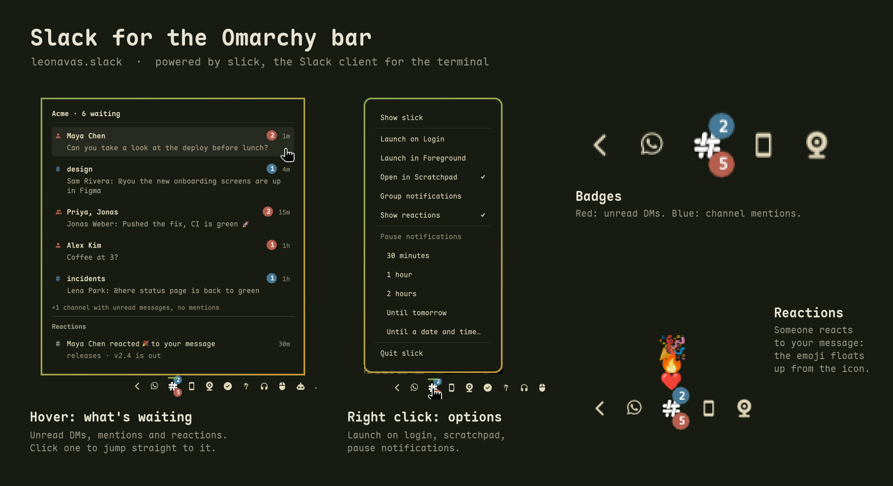

# Slack for the Omarchy bar



A bar widget for [Omarchy](https://omarchy.org) that puts Slack in your bar
the way a tray icon would, through [slick](https://slick.leonavas.com).
slick is a fast, lightweight Slack client for the terminal, written in Rust
([source](https://github.com/leonavas/slick)).

## What it does

- **Icon.** slick's mark in the bar (white with a faint outline by default,
  readable on light and dark bars). It is dimmed while slick is not running.
- **Badges.** Red at the bottom-right counts unread messages in DMs and group
  DMs, plus thread replies that mention you. Blue at the top-right counts
  channel mentions, the unread channels that notify you and new replies in
  the threads you follow. A channel you muted or set to mentions only in Slack only
  counts in the preview's footer. "Channel mentions only" in the menu narrows
  the blue badge and the rows to channels that mention you. A badge with
  nothing to count is not drawn.
- **Combined mode.** "Group notifications" in the menu folds both into one
  red badge with their sum.
- **Hover preview.** Hover the icon to see the unread conversations: who, their
  unread messages ("Ana: can you review the PR?") with Slack's bold and italic
  and the workspace's own emoji (GIFs animated), mention count and how long ago.
  Click a conversation to jump straight to it in slick. Below them, the
  threads you follow with new replies (where, the thread's first message and
  its latest reply; a click opens the thread), then the
  reactions people put on your messages ("Ana reacted 👍 to your message"),
  which never add to the badges.
- **Reaction bubbles.** A new reaction floats up out of the icon, Slack's
  own emoji (custom and animated ones included) when slick has it. Not
  while notifications are paused.
- **Scratchpad parking.** slick lives in Omarchy's scratchpad (SUPER+S). A
  click shows it, another click puts it away without closing it, so it keeps
  running and counting.
- **Menu (right click).** Launch on Login, Launch in Foreground, Open in
  Scratchpad, Group notifications, Channel mentions only, Show threads, Show reactions, pause notifications (30 minutes, 1 hour,
  2 hours, until tomorrow, or until a day and time you pick) or resume them,
  and Quit slick.
- **Pause notifications** uses Slack's own do-not-disturb, so the pause
  follows your account to every client and works even with slick closed.
  While a pause you set is on, the badges give way to a small bell-off mark.
  Slack's scheduled night-time DND keeps the badges.
- **Not installed?** Without slick on your `PATH`, the icon dims and its card
  links to [slick.leonavas.com](https://slick.leonavas.com), where to get it.
  The widget picks slick up on its own once installed.

| Mouse | Action |
|---|---|
| Left click | Open slick, show it, or put it away |
| Middle click | Quit slick |
| Right click | The menu |
| Hover | Preview of unread conversations |

## Requirements

- Omarchy, with its shell (the Quickshell bar).
- [slick](https://slick.leonavas.com), installed on its own (step 1 below).

## Install

The widget is the bar side of slick: it needs slick installed first. On its
own it only shows a dimmed icon whose card points to slick's install page.

**1. Install slick.** Follow
[slick.leonavas.com/#install](https://slick.leonavas.com/#install): one
command, no sudo. It downloads the latest release for your architecture,
checks its SHA-256 and puts `slick` in `~/.local/bin`. Prefer to build it?
The [slick README](https://github.com/leonavas/slick#install) has the source
route. Then run `slick` once in a terminal to sign in to your workspace.

**2. Add the widget.**

```bash
omarchy plugin add https://github.com/leonavas/omarchy-slack.git
omarchy plugin enable leonavas.slack --section right
```

To update later: `omarchy plugin update leonavas.slack`, then
`omarchy restart shell`.

## Remove

```bash
omarchy plugin remove leonavas.slack
```

It unloads the widget from the bar and deletes the plugin folder. The plugin
writes nothing outside its entry in `~/.config/omarchy/shell.json`. slick
itself stays installed; see [slick.leonavas.com](https://slick.leonavas.com)
to remove it.

## Settings

Change them in the bar's widget settings panel, or inline on the widget's entry
in `~/.config/omarchy/shell.json`, e.g.
`{ "id": "leonavas.slack", "badgeLayout": "Combined" }`.

| Key | Default | What it does |
|---|---|---|
| `launchCommand` | `""` | Empty runs `omarchy-launch-tui --app-id=<windowClass> slick`. Anything else must open a window with class `windowClass` |
| `windowClass` | `org.omarchy.slick` | The slick window the widget drives |
| `iconStyle` | `Outline` | `Outline`, `Color` (colored mark), `Mono` (tinted like the bar's glyphs) or `Glyph` |
| `glyph` | `󰒱` | Nerd Font character for the `Glyph` style |
| `glyphSize` | `0` | Glyph size in px; 0 follows the bar |
| `glyphOffsetY` | `0` | Vertical nudge for the glyph, in px |
| `badge` | `Count` | `Count`, `Dot` or `None` |
| `badgeLayout` | `Split` | `Split` (red DMs + blue channels) or `Combined` (one red badge) |
| `dmColor` | `#b65f4e` | DM badge color |
| `channelColor` | `#467996` | Channel badge color |
| `channelBadge` | `Unread` | What the blue badge counts: `Unread` (mentions, channels that notify you and thread replies), `Mentions`, `All unread` or `None` |
| `badgeScale` | `0.45` | Dot size, as a fraction of the icon |
| `tintWhenUnread` | `false` | Color the mark too (`Mono` and `Glyph` styles) |
| `hideMode` | `Special workspace` | What a click on the open window does: park it, or `Never hide` |
| `specialWorkspace` | `scratchpad` | The special workspace slick parks in |
| `openInSpecial` | `true` | slick opens straight into that workspace |
| `autoStart` | `false` | Open slick when the shell starts (Launch on Login) |
| `launchForeground` | `true` | Show and focus slick when it opens; off, it opens hidden |
| `dimWhenClosed` | `true` | Dim the icon while slick is not running |
| `hideWhenNotRunning` | `false` | Remove the icon while slick is not running |
| `middleClickCloses` | `true` | Middle click quits slick |
| `hoverPreview` | `true` | Show the preview on hover |
| `previewRows` | `6` | Conversations in the preview, and threads and reactions below them |
| `channelMentionsOnly` | `false` | Channels count only when they mention you: no row or blue badge for the ones that notify you |
| `previewChannels` | `false` | Also list muted and mentions-only channels |
| `showThreads` | `true` | List threads you follow with new replies and count those replies in the badges |
| `showReactions` | `true` | List reactions to your messages and float new ones out of the icon |
| `mutedIndicator` | `Bell` | While paused: `Bell`, `Dim` or `None` |

## How it works

slick publishes what it knows to `$XDG_RUNTIME_DIR/slick/state.json`,
rewriting it atomically whenever something changes: unread counts, the latest
unread messages per conversation, threads you follow with new replies,
reactions to your messages, and the do-not-disturb state. The widget
watches that file. It is ignored whenever no slick window is open, so a crash
never leaves a stale badge behind.

Actions go back through slick's command line:

- `slick open <conversation> [ts] [--thread <ts>]`: jump to a conversation
- `slick quit`: close slick
- `slick dnd pause <minutes>`, `slick dnd resume`, `slick dnd status`

The file format is documented in
[docs/events.md](https://github.com/leonavas/slick/blob/master/docs/events.md).
[`NOTES.md`](NOTES.md) has the design decisions that are not obvious from the
code.

## Troubleshooting

- **Changes to the plugin do not show up.** After updating or editing the
  plugin, run `omarchy restart shell`. The shell's own reload keeps running
  the old code.
- **Two icons.** slick also has a tray icon of its own. Turn it off in slick's
  Settings (account menu), or with `tray = false` in `~/.config/slick/config`.
- **No badges or preview.** Check that slick is running and that
  `$XDG_RUNTIME_DIR/slick/state.json` exists. The widget only trusts it while
  a window of class `org.omarchy.slick` is open, so a slick started some other
  way needs `windowClass` set to its class.

## License

MIT, see [`LICENSE`](LICENSE).
